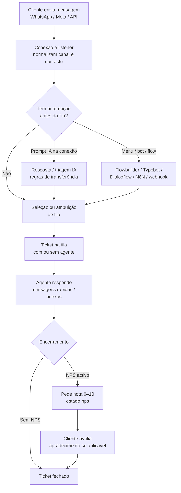

# Memorial para apresentação — Atlas Digital

Documento para montar **slides (PPT)** e alimentar **IAs de imagem**, e ainda para quem precisa da **história do produto** — não só uma lista de telas. **Produto:** *Atlas Digital* · **Código / repositório:** *atlas-digital* (frontend React + backend Node/TypeScript).

Documentação operacional e técnica continua em [MANUAL-OPERADOR.md](./MANUAL-OPERADOR.md), [MANUAL-TECNICO.md](./MANUAL-TECNICO.md) e [INTEGRACOES-QUEUE-FLOW.md](./INTEGRACOES-QUEUE-FLOW.md).

---

# Bloco A — Memorial enxuto (pitch + slides)

## Frase de abertura (slide título)

**Atlas Digital liga o cliente ao teu melhor atendimento — num só ecossistema: conversas, filas, automação, IA, campanhas, relatórios e satisfação medida, em tempo quase real.**

---

## O que é (30 segundos)

Plataforma **web** para **central de atendimento omnicanal** centrada em **tickets** (conversas): **WhatsApp** (sessão via stack Baileys no backend), **Facebook / Instagram** (webhook Meta), equipa no **painel**, **filas** e **utilizadores**, com camadas de **automação** (menus, Flowbuilder, Typebot, Dialogflow, N8N, webhooks) e **IA** (OpenAI / Gemini quando o plano permite). Inclui **Socket.IO** para notificações e estado vivo no browser.

---

## Atlas Digital em camadas: do “barulho” à decisão

Isto complementa o parágrafo dos 30 segundos com uma **mensagem de venda** mais densa — podes usar como **slide único** (com ícones) ou como **guion** para o apresentador.

### 1. Concentrador de interações (o “trunk” de tudo o que chega)

- **Um só lugar** onde entram conversas vindas de **vários canais** (ex.: WhatsApp, Facebook, Instagram), em vez de equipas a saltar entre telemóveis pessoais e contas partilhadas.
- Cada interação vira **ticket**: fica **associada a um contacto**, com **histórico único**, anexos quando suportados e estado claro (aberto, em fila, com agente, NPS, encerrado).
- **Benefício comercial:** menos conversas “perdidas”, menos “já te disse isso ao teu colega”, mais **rastreabilidade** para disputas, auditoria e formação.

### 2. Gestão de atendentes, filas e papéis (quem faz o quê)

- **Utilizadores** com perfis (**utilizador**, **admin**, **super**) e, ainda, **permissões finas** (ex.: ver dashboard, ver tempo real, gerir conexões) sem obrigar todos a serem administradores.
- **Filas** como “linhas de negócio”: Comercial, Suporte, Financeiro, etc., cada uma com a sua lógica e, quando contratado, **integração** (bot, fluxo, IA).
- **Benefício comercial:** especialização da equipa, **escala** sem caos, e **responsabilização** (sabe-se que fila e, muitas vezes, que pessoa tratou o caso).

### 3. Visão das ações em tempo quase real (a operação “respira” no ecrã)

- O painel **actualiza-se** com eventos do servidor (**Socket.IO** por empresa): novas mensagens, mudanças de ticket, chat interno, etc.
- Área de **momentos** (quando habilitada) para supervisão **ao vivo** do que está a decorrer — útil para **qualidade**, **escalação** e **onboarding** de novos atendentes.
- **Benefício comercial:** o supervisor deixa de depender de “vai lá ver o ecrã dele” — passa a ter **situational awareness** sem invadir o cliente.

### 4. Dashboards e relatórios (do feeling aos números)

- **Dashboard** agrega indicadores da operação; **relatórios** aprofundam períodos, filas, desempenho e exportação para quem precisa de **Excel**, auditoria ou reuniões de direcção.
- **Benefício comercial:** decisões de **staffing**, horários de pico, e prioridades de produto/suporte com **base em dados**, não só em reclamações pontuais.

### 5. Fluxos de atendimento automatizados (primeira linha inteligente + consistente)

- **Antes do humano:** menus de filas, **Flowbuilder** (grafos visuais), **Typebot**, **Dialogflow**, **N8N** ou **webhooks** para falar com CRM/ERP; **prompts** de **OpenAI / Gemini** na conexão quando o plano inclui IA — triagem, FAQ, coleta de dados.
- **Durante o humano:** **mensagens rápidas**, etiquetas, notas, transferências, biblioteca de **ficheiros** — velocidade com **padrão de marca**.
- **Depois do humano:** **NPS** (0–10) quando configurado, encerramento disciplinado do ticket.
- **Benefício comercial:** **custo por contacto** tende a baixar onde a automação é bem desenhada; **satisfação** tende a subir onde o humano entra **no momento certo**, já informado.

### 6. Proatividade, integração e plataforma (quando o negócio cresce)

- **Campanhas** e **listas** para comunicação segmentada; **API de mensagens** para o teu ecossistema (site, app, ERP) disparar conversas de forma controlada (conforme plano).
- **Multi-empresa**, **planos** e **financeiro** para modelos **SaaS**, grupo ou revenda — com **configurações globais** (SMTP, Mercado Pago, branding do login) para quem opera a plataforma.
- **Benefício comercial:** o Atlas Digital deixa de ser “software de uma loja” e passa a ser **infraestrutura** para **várias marcas** ou **várias unidades**.

### Síntese numa frase (para rodapé de slide)

**Entra o tráfego por vários canais; o Atlas Digital concentra, encaminha, automatiza, deixa ver tudo em tempo real, mede com dashboards e fecha o ciclo com satisfação — com humanos e máquinas no sítio certo.**

---

## Pilares do produto (4 blocos)

| Pilar | O que entrega |
|--------|----------------|
| **Gestão** | Dashboard, relatórios, “momentos” em tempo real (conforme permissões), utilizadores, filas, contactos, etiquetas, empresas/planos (multi-tenant), definições e **configurações globais** (super admin: SMTP, Mercado Pago, branding do login, trial). |
| **Operação** | Tickets, mensagens rápidas, Kanban, agendamentos (plano), chat interno entre colaboradores (plano), importação de contactos, ficheiros, ajuda contextual. |
| **Automação & canais** | Conexões WhatsApp, integrações de fila, Flowbuilder (grafos visuais), prompts de IA na conexão, campanhas e listas (plano), API de mensagens (plano). |
| **Confiança & experiência** | NPS pós-atendimento (0–10), logs de conversa no ticket, separação por empresa, documentação de ligações externas, deploy Linux documentado (Nginx + PM2). |

---

## Funcionalidades em destaque (para “surpreender” no pitch)

1. **Um ticket, toda a história** — Cliente não repete o contexto; agente vê mensagens, contacto, fila, etiquetas e notas conforme configuração.
2. **Automação sem monopólio de fornecedor** — Typebot, Dialogflow, N8N, webhook genérico, **Flowbuilder próprio** e IA na conexão; combinas o que já usas no stack.
3. **Uma central que “enxerga” a operação** — Dashboard, relatórios, supervisão em **momentos**, alertas visuais no menu (ex.: estado das conexões).
4. **Omnicanal de verdade** — O mesmo modelo mental de **ticket** estende-se a canais Meta, com webhook dedicado no backend.
5. **Monetização da plataforma** — Planos por empresa, financeiro, integração com **Mercado Pago** ao nível global (`/global-config`) para quem revende SaaS.
6. **Proatividade comercial** — Campanhas segmentadas por **listas de contactos** e relatórios por campanha (quando licenciado).
7. **Governança fina** — Perfis `user` / `admin` / `super`, flags por utilizador (`showDashboard`, `allowRealTime`, `allowConnections`) e **flags de plano** (`useCampaigns`, `useKanban`, `useOpenAi`, `useIntegrations`, `useSchedules`, `useInternalChat`, `useExternalApi`).

---

## Para quem é

- **Contact centers**, **suporte**, **vendas** e **back-office** que hoje misturam WhatsApp pessoal, e-mail e folhas sem métrica.
- **Operações digitais** que precisam de **bots + humano** no mesmo fluxo, com **escala** (filas, vários atendentes, várias marcas/empresas).
- **Integradores e revendedores** que querem **marca branca** (login, SMTP, pagamentos) e **multi-empresa**.

---

## Stack (slide técnico — opcional)

| Camada | Tecnologia (resumo) |
|--------|---------------------|
| **Frontend** | React (CRA), Material-UI, React Router — `frontend/`. |
| **Backend** | Node.js, Express, TypeScript, Sequelize — `backend/`. |
| **Dados** | PostgreSQL. |
| **Tempo real & jobs** | Socket.IO (namespaces por empresa), Redis + **Bull** (campanhas, agendamentos, monitores). |
| **Estático / uploads** | `backend/public/company{id}/` |

Detalhe: [MANUAL-TECNICO.md](./MANUAL-TECNICO.md).

---

## Roteiro sugerido de slides (10–12)

1. Título + tagline (frase de abertura)  
2. Problema: conversas espalhadas (telefone pessoal + Excel + e-mail)  
3. Solução: Atlas Digital numa frase  
4. Ticket + omnicanal (WhatsApp + Meta)  
5. Filas e conexões (encaminhamento inteligente)  
6. Automação: Flowbuilder + integrações + IA (print ou diagrama)  
7. Supervisão: dashboard, relatórios, momentos  
8. Campanhas e listas (se o pacote incluir)  
9. NPS e melhoria contínua  
10. Multi-empresa, planos e financeiro (modelo SaaS)  
11. Segurança e documentação (referência a privacidade / deploy)  
12. Fechamento: próximo passo / demonstração / contacto  

---

## Prompts para IA de imagens (copiar por slide)

Use no Midjourney, DALL·E, Ideogram, etc. Evita texto ilegível ou marcas registadas de terceiros.

| # | Ideia do slide | Prompt sugerido (inglês costuma funcionar melhor) |
|---|----------------|---------------------------------------------------|
| 1 | Capa premium | *Minimal corporate hero, customer experience technology, chat bubbles merging into a calm command dashboard, deep blue and teal accents, dark background, no readable text, cinematic lighting, 16:9* |
| 2 | Caos operacional | *Split scene: chaotic phone screens and sticky notes on one side, unified clean support inbox UI on the other, metaphor illustration, flat modern style, 16:9* |
| 3 | Visão única | *Isometric contact center with agents at curved monitors, glowing conversation threads routing to queues, professional vector 3D, enterprise SaaS, 16:9* |
| 4 | Omnicanal | *Abstract network: smartphone message icon linked to social and web chat silhouettes, converging into one inbox pipeline, soft gradients, 16:9* |
| 5 | Automação / IA | *Flowchart nodes floating in space, subtle neural glow, human silhouette shaking hands with automation robot outline, friendly not scary, 16:9* |
| 6 | Flowbuilder | *Visual node graph editor on large screen, cables connecting message and decision blocks, clean UI mockup abstract, 16:9* |
| 7 | Supervisor | *Over-the-shoulder view of manager watching live conversation tiles, charts in corner, daylight office, photorealistic, 16:9* |
| 8 | Campanhas | *Targeted notification waves over audience clusters, ethical marketing vibe, modern illustration, 16:9* |
| 9 | NPS / satisfação | *Five to ten star motif abstract, upward sentiment curve, warm professional palette, editorial illustration, 16:9* |
| 10 | Multi-tenant / SaaS | *Stacked company cards behind one branded portal door, subtle lock icons, trust and scale, 16:9* |
| 11 | Fechamento | *Sunrise over modern office skyline, single glowing thread connecting building to horizon, inspirational corporate photo style, text space left third, 16:9* |

---

## Mensagem final (último slide — bloco A)

**Atlas Digital não é “mais um chat” — é o fio condutor entre o cliente e a tua operação, com automação onde escala, humanos onde importa, e números onde decides.**

---

# Bloco B — História, fluxos e “alma” do produto

**Para quem é este texto:** quem precisa de *entender por que o sistema existe na lógica Atlas Digital*, **como uma mensagem vira ticket, fila e métrica**, e **como encaixar licenciamento e treino**.

**Nota técnica:** o repositório chama-se **atlas-digital**; no painel e na doc interna usa-se **Atlas Digital**. Integrações críticas (ordem bot vs fila vs IA) estão descritas em [INTEGRACOES-QUEUE-FLOW.md](./INTEGRACOES-QUEUE-FLOW.md) — **não duplicar aqui cada condição de código**, apenas o raciocínio de negócio.

---

## Parte I — A história (como foi pensado o “núcleo”)

### O ponto de partida: conversa, não só “caixa de entrada”

O mercado já tinha **mensagens**; o que falta muitas vezes é **estrutura**: quem respondeu, em nome de que departamento, com que SLA, com que histórico partilhado e com que **prova** para o cliente e para a auditoria. O Atlas Digital organiza tudo em torno do **ticket**: uma conversa com estado, dono opcional, fila opcional e canal (WhatsApp, Facebook, Instagram…).

### Conectar mundos: integrações desde o primeiro desenho

Operações maduras não querem **reeinventar** o bot a cada fornecedor. Por isso existem **integrações de fila** (Dialogflow, N8N, webhook, Typebot, Flowbuilder) e **IA na conexão** (prompts OpenAI/Gemini), além de **webhook Meta** para redes sociais — ou seja, o mesmo motor de **mensagens e tickets** conversa com **ecossistemas externos** que a tua empresa já adoptou.

### A segunda onda: de atender a medir e a crescer

Quando o volume sobe, surgem perguntas de gestão: **quantos tickets por fila?**, **quanto tempo até primeira resposta?**, **o cliente ficou satisfeito?** Daí **dashboard**, **relatórios**, **NPS** após fecho (quando activo) e, para equipas comerciais, **campanhas** e **listas** no mesmo universo de **contactos**.

### A terceira onda: plataforma, não só “ferramenta de mesa”

**Multi-empresa**, **planos**, **financeiro**, **global-config** (SMTP, Mercado Pago, imagens do login, trial) e **API de mensagens** fecham o círculo para **revenda**, **holding** ou **IT interno** que integra ERP e e-commerce.

---

## Parte II — Linhas de produto (como o time pode enxergar internamente)

Na prática do código e dos menus, podes agrupar assim (ajusta ao teu **contrato comercial**):

| Linha | O que agrupa | Rotas típicas (painel) |
|-------|----------------|-------------------------|
| **Atendimento & CX** | Tickets, mensagens rápidas, contactos, tags, Kanban, importação | `/tickets`, `/quick-messages`, `/contacts`, `/tags`, `/Kanban`, `/TagsKanban` |
| **Supervisão & dados** | Dashboard, relatórios, momentos | `/`, `/reports`, `/moments` |
| **Automação & canais** | Conexões, filas, integrações, Flowbuilder, prompts | `/connections`, `/queues`, `/queue-integration`, `/flowbuilders`, `/flowbuilder/:id`, `/prompts` |
| **Proatividade** | Campanhas, listas, config, relatório de campanha, listas de frases | `/campaigns`, `/contact-lists`, `/campaigns-config`, `/campaign/.../report`, `/phrase-lists` |
| **Colaboração & agenda** | Chat interno, agendamentos, to-do, ficheiros, ajuda | `/chats`, `/schedules`, `/todolist`, `/files`, `/helps` |
| **Plataforma & governança** | Utilizadores, financeiro, definições, empresas, anúncios (super), global-config | `/users`, `/financeiro`, `/settings`, `/companies`, `/announcements`, `/global-config`, `/messages-api`, `/allConnections` |

Para o **cliente final**, vende-se como **um Atlas só**; para **implantação**, ajuda saber **o que licenciar** (flags de plano) e **o que treinar primeiro** (tickets + filas antes de Flowbuilder profundo).

---

## Parte III — O fluxo-mãe (da mensagem do cliente ao ticket encerrado)

A história operacional, em sequência, é esta.

### Passo 1 — Entra uma **mensagem**

O canal (ex.: WhatsApp) chega à **conexão** configurada; o sistema associa ou cria **contacto** e **ticket**, mantendo **histórico** único.

### Passo 2 — **Automação** (opcional, mas é aqui que escala)

Conforme configuração da conexão e da fila, pode correr **IA na conexão** (`promptId`), **integração** global na conexão, ou fluxo na **fila** — a ordem exacta e exclusões (grupo, `fromMe`, etc.) estão no listener documentado; para **venda**, o que importa é: **primeira resposta rápida** sem obrigar o humano a copiar/colar FAQ.

### Passo 3 — **Fila** = especialização

A fila encaminha para o **conjunto de agentes** certo, com possíveis **horários**, **opções** e **integrações** próprias.

### Passo 4 — **Agente** no painel

O operador usa `/tickets`: vê contexto, transfere, etiqueta, anexa ficheiros da biblioteca, usa **mensagens rápidas** para consistência.

### Passo 5 — **Estados** que importam para negócio

| Estado (conceito) | Significado resumido |
|--------------------|------------------------|
| Aberto / em atendimento | Conversa activa com dono ou em fila. |
| Pendente | Aguarda cliente ou processo interno (conforme uso da equipa). |
| **NPS** | Pedido de avaliação enviado; aguarda nota antes de fechar de vez. |
| Fechado | Ciclo concluído; mantém-se histórico e relatórios. |

### Passo 6 — **Medir** (NPS e relatórios)

Com **userRating** activo e mensagens configuradas, o cliente pode classificar **0–10**; o sistema regista e fecha o ciclo de forma **auditável** — base para **one-to-ones**, **bónus** e **melhoria de scripts**.

---

## Parte IV — Lista enxuta por bloco (checklist comercial)

### Atendimento

- Tickets com lista, detalhe e URL `/tickets/:ticketId`.
- Mensagens rápidas; notas e etiquetas conforme permissões.
- Transferência entre filas/utilizadores; canais Meta no mesmo paradigma.

### Automação

- Flowbuilder: lista `/flowbuilders` e editor `/flowbuilder/:id`.
- Integrações de fila em `/queue-integration` (plano `useIntegrations`).
- Prompts em `/prompts` (plano `useOpenAi`).

### Marketing / proactividade

- Campanhas, listas, configuração, relatório (plano `useCampaigns`; no router do frontend as rotas de campanha podem ainda depender de `localStorage` `cshow` — alinha a tua build comercial com o técnico).

### Operação ampliada

- Kanban `/Kanban` (rota exacta com **K** maiúsculo no código; o menu pode usar minúsculas — validar no teu ambiente).
- Tags Kanban `/TagsKanban`.
- Agendamentos `/schedules` (`useSchedules`).
- Chat interno `/chats` (`useInternalChat`).

### Plataforma

- Login, registo, recuperação de palavra-passe ([RECUPERACAO-SENHA.md](./RECUPERACAO-SENHA.md)).
- Utilizadores, filas, conexões, ficheiros, financeiro, definições.
- Super: `/global-config`, `/announcements`, visão alargada de conexões `/allConnections` quando aplicável.

### Confiança & compliance (mensagem)

- Mapa de **ligações externas**: [LIGACOES-EXTERNAS-E-PRIVACIDADE.md](./LIGACOES-EXTERNAS-E-PRIVACIDADE.md).
- **Deploy** referência: [DEPLOY-PRODUCAO-LINUX.md](./DEPLOY-PRODUCAO-LINUX.md).

---

## Parte V — O que este documento **não** substitui

- **Contrato comercial** (módulos e limites que o cliente compra).
- **RGPD / LGPD** e políticas internas da empresa operadora (opt-in de campanhas, retenção de dados — o sistema dá **mecânica**, a política é **tua**).
- **Runbook** com segredos (tokens Meta, API keys, credenciais Mercado Pago — nunca num memorial público genérico).

---

## Parte VI — Uma frase para guardar

**O Atlas Digital começou na pergunta “quem atende isto e onde fica o registo?” — cresceu para “como faço o cliente sentir-se ouvido 24/7 sem perder o humano?” e “como provo isso com números?” — e fecha o ciclo com “como vendo e opero isto em escala?” — multi-empresa, planos e integrações.**

---

## Referências internas (ligações úteis)

| Documento | Ligação |
|-----------|---------|
| Índice da documentação | [docs/README.md](./README.md) |
| Operador | [MANUAL-OPERADOR.md](./MANUAL-OPERADOR.md) |
| Técnico | [MANUAL-TECNICO.md](./MANUAL-TECNICO.md) |
| Integrações, prompts, global-config | [INTEGRACOES-QUEUE-FLOW.md](./INTEGRACOES-QUEUE-FLOW.md) |
| Recuperação de senha | [RECUPERACAO-SENHA.md](./RECUPERACAO-SENHA.md) |
| Privacidade / endpoints externos | [LIGACOES-EXTERNAS-E-PRIVACIDADE.md](./LIGACOES-EXTERNAS-E-PRIVACIDADE.md) |
| Deploy produção Linux | [DEPLOY-PRODUCAO-LINUX.md](./DEPLOY-PRODUCAO-LINUX.md) |

---

*Memorial modelado a partir da estrutura “v1 enxuta + v2 narrativa” de apresentação comercial; conteúdo técnico alinhado ao repositório **atlas-digital**. Ajusta nomes de pacotes, logos e métricas de ROI aos teus casos reais.*
